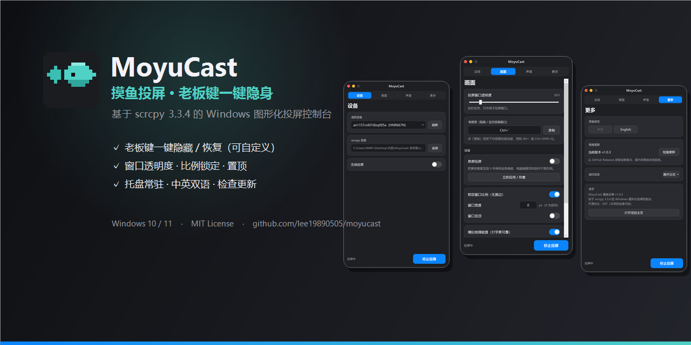
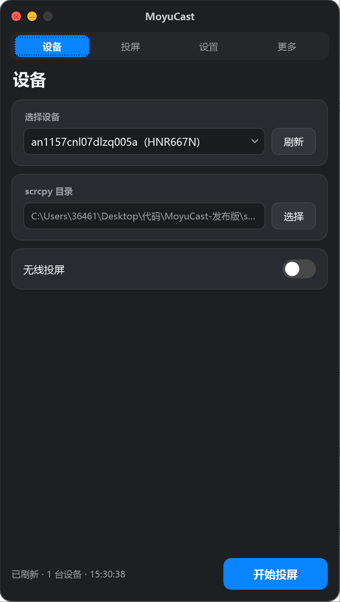
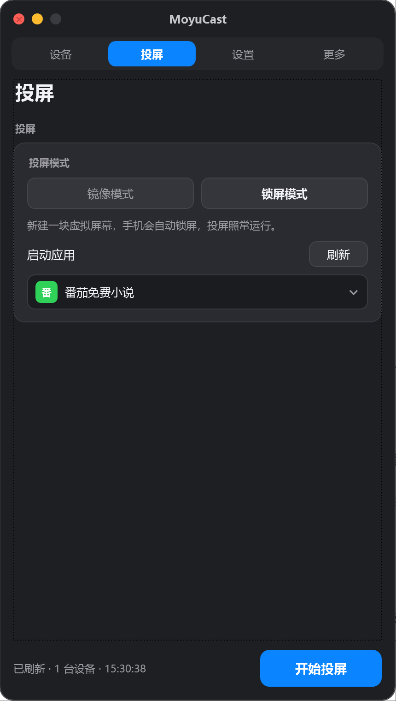
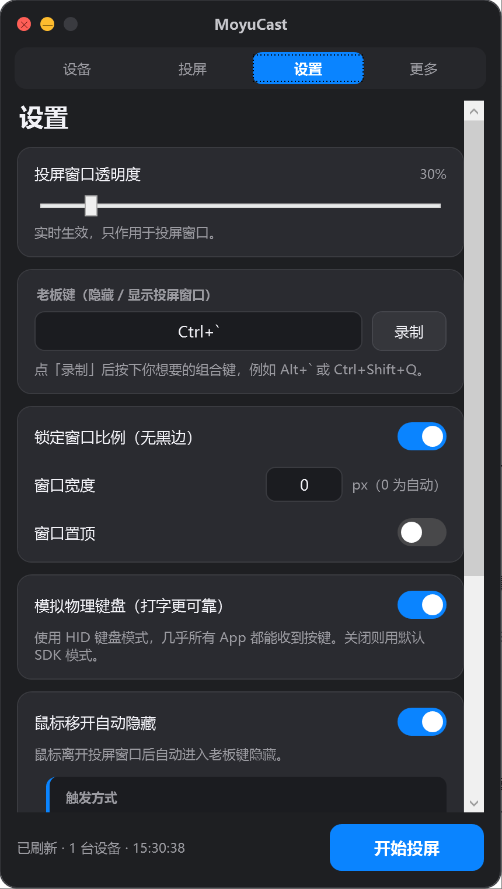
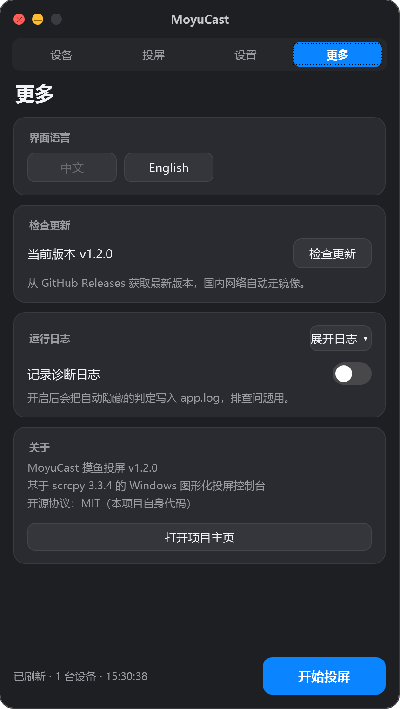
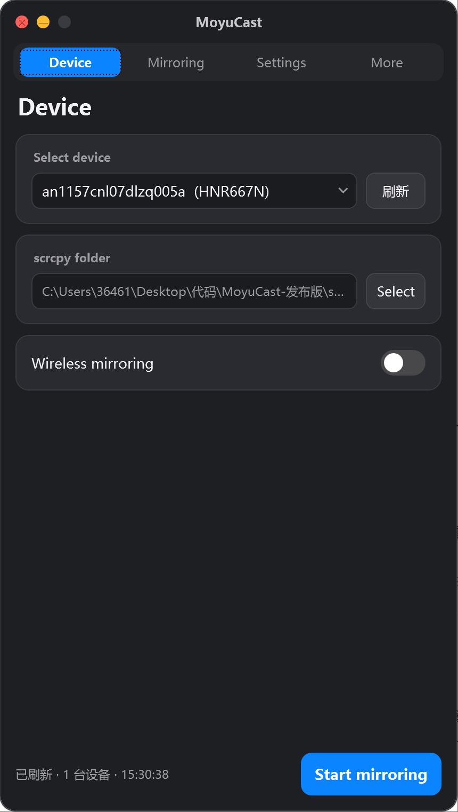
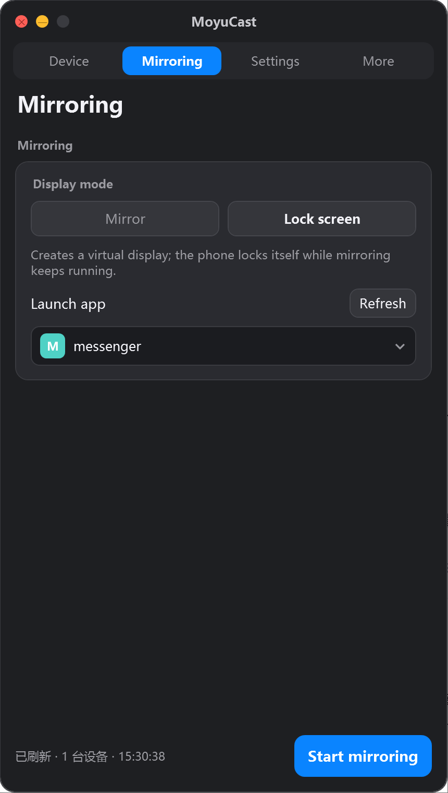
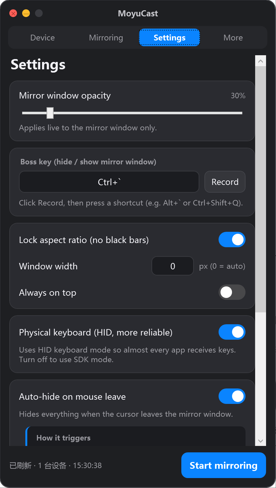
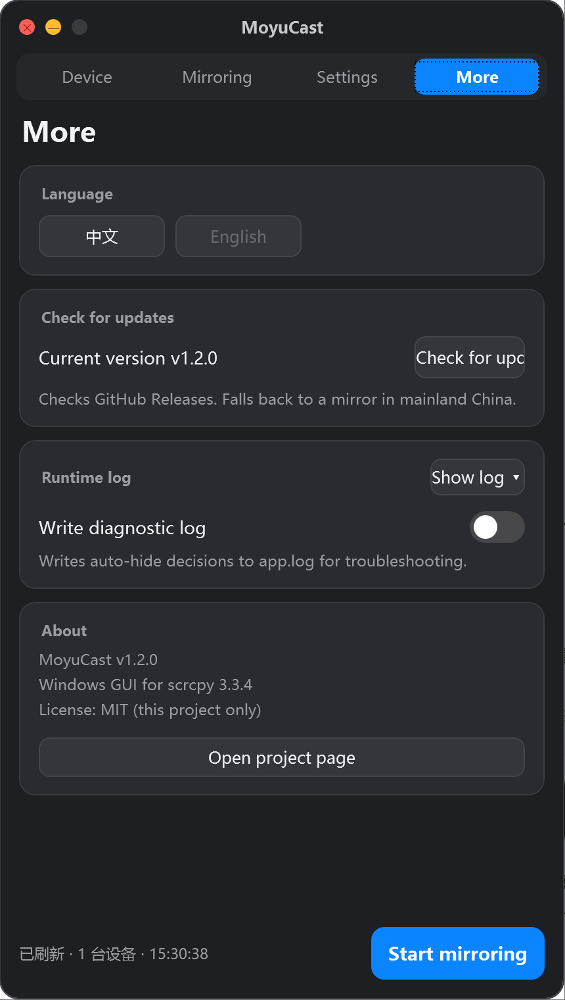

<div align="center">

# 🐟 MoyuCast · 摸鱼投屏

**老板来了？一键消失。**

*Boss incoming? One key, and it''s gone.*

[](https://github.com/lee19890505/moyucast/stargazers)
[](https://github.com/lee19890505/moyucast/releases)
[](https://github.com/lee19890505/moyucast/releases/latest)
[](https://github.com/lee19890505/moyucast/issues)
[](https://github.com/lee19890505/moyucast/commits/main)
[](LICENSE)


<a href="https://github.com/lee19890505/moyucast/releases/latest">
  
</a>

[🇨🇳 中文](#-中文) · [🇬🇧 English](#-english)

</div>

---

# 🇨🇳 中文

## 这是什么

**MoyuCast** 是一个基于开源投屏工具 [scrcpy](https://github.com/Genymobile/scrcpy) 的 Windows 图形化控制台。

它解决一个非常严肃的办公问题：

> **上班偷偷看手机，老板一走过来怎么办？**

答案是：**按一下热键，屏幕上什么都不剩。**

手机画面瞬间消失，设置窗口也一起消失，桌面干干净净——老板只会看到你认真盯着 Excel。

再按一下，一切原样回来，连窗口大小、位置、透明度都和刚才一模一样。

## 界面预览

<p align="center">
  
  
  
  
</p>
<p align="center">
  
</p>

## 为什么不用原版 scrcpy

原版 scrcpy 很强，但它是命令行工具：

- 要记一长串参数
- 老板键？没有
- 窗口透明度？没有
- 鼠标移开自动隐藏？没有
- 无线投屏要自己敲 `adb tcpip` + `adb connect`
- 一开就是黑窗口，关掉黑窗口投屏也关了

MoyuCast 把这些全部做成了按钮和开关。

## 功能

### 🕵️ 摸鱼核心

| 功能 | 说明 |
|---|---|
| **老板键** | 全局热键，一键隐藏「投屏窗口 + 设置窗口」，任意组合键可录制 |
| **状态完整还原** | 隐藏前的位置、大小、透明度、最小化状态，恢复后一模一样 |
| **鼠标移开自动隐藏** | 鼠标离开投屏区域 0.5 秒自动消失，按热键恢复 |
| **窗口透明度** | 20% ~ 100% 实时调节，可以调成"若隐若现" |
| **窗口置顶开关** | 需要时置顶，不需要时随手关掉 |

### 📱 投屏

| 功能 | 说明 |
|---|---|
| **USB 直连** | 插线即用，自动识别 |
| **无线一键投屏** | 自动读取手机 IP、切 TCP、连接，一步到位 |
| **首次配对** | 支持 Android 11+ 无线调试的 6 位配对码 |
| **两种投屏模式** | 镜像模式：画面即手机屏幕；锁屏模式：新建虚拟屏，手机可锁屏 |
| **锁屏投屏** | 选一个 App，点开始后自动打开并锁屏，手机黑屏也能继续看和操作 |
| **App 选择器** | 自动读取手机第三方 App，支持星标置顶、原生图标、刷新 |
| **锁定宽高比** | 拖窗口自动保持比例，拒绝黑边 |
| **窗口记忆** | 关闭后记住投屏窗口位置/大小/透明度，下次原样恢复 |

### 🔊 声音

| 模式 | 行为 |
|---|---|
| 手机响（默认） | 声音留在手机，电脑不继承 |
| 两边响 | 手机和电脑同时出声（Android 13+） |
| 仅电脑 | 声音转到电脑，手机静音 |

### ⌨️ 操作

- 鼠标点击、拖拽、滚轮全部可用
- 键盘输入（HID 物理键盘模式，打字更可靠）
- 剪贴板双向同步
- 拖拽 APK 到窗口即安装

### 🎨 界面

- macOS 风格深色主题：红黄绿信号灯、圆角卡片、iOS 风格开关
- 竖屏比例 430 × 760，可自由拉伸
- 四个页签：设备 / 投屏 / 设置 / 更多（更新、日志、关于都收在这里，日志点击才展开）
- 中英双语：默认跟随系统，应用内一键切换
- 启动投屏有加载动画和耗时记录

### 🧰 其他

- **托盘图标**：最小化到托盘，双击恢复；托盘菜单可直接开始 / 停止投屏
- **单实例**：重复启动只会唤醒已有窗口，不会开出第二个进程
- **应用内检查更新**：读取 GitHub Releases，国内网络自动走镜像
- **像素风图标**：16 ~ 256 多尺寸 ICO，应用和托盘统一使用
- **中英双语**：默认跟随系统语言，「更多」页可一键切换，立即生效无需重启

## 更新日志

见 [CHANGELOG.md](CHANGELOG.md)。

## 快速开始

### 1. 手机准备

1. 设置 → 关于手机 → 连点「版本号」7 次
2. 开发者选项 → 打开 **USB 调试**
3. 插数据线 → 通知栏选「传输文件」→ 允许 USB 调试

### 2. 运行

1. 到 [Releases](../../releases) 下载 `MoyuCast-win64.zip`
2. 解压，双击 `MoyuCast.exe`
3. 「设备」页选中手机 → 点「开始投屏」

> 绿色版自带 .NET 运行时和 scrcpy，**不需要安装任何环境**。

## 老板键

默认 **`Ctrl+Alt+H`**，在「外观」页点「录制」可自定义。

| 操作 | 效果 |
|---|---|
| 按一次 | 投屏窗口 + 设置窗口一起隐藏 |
| 再按一次 | 两个窗口原样恢复 |
| 没在投屏时按 | 只隐藏/恢复设置窗口 |

## 常见问题

<details>
<summary><b>Windows 提示"未知发布者"</b></summary>

程序没有代码签名。点「更多信息 → 仍要运行」即可。
</details>

<details>
<summary><b>提示找不到 scrcpy</b></summary>

「设备」页 → **scrcpy 目录** → 点「选择」，指向含 `scrcpy.exe` 的文件夹。
</details>

<details>
<summary><b>设备显示 offline</b></summary>

拔插数据线，重新允许 USB 调试，或点「刷新」。
</details>

<details>
<summary><b>息屏后屏幕看起来没变</b></summary>

程序通过把亮度压到 0 实现"伪息屏"。部分墨水屏机型的前光由厂商私有服务控制，系统接口关不掉，属于硬件/ROM 限制。
</details>

<details>
<summary><b>键盘打字没反应</b></summary>

确认「画面」页的「模拟物理键盘（HID）」已开启（默认开启）。
</details>

## 从源码构建

```bash
git clone https://github.com/<your-name>/moyucast.git
cd moyucast/MoyuCast
dotnet publish -c Release -r win-x64 --self-contained true \
  -p:PublishSingleFile=true -p:IncludeNativeLibrariesForSelfExtract=true \
  -p:EnableCompressionInSingleFile=true -o ../dist
```

然后把 [scrcpy](https://github.com/Genymobile/scrcpy/releases) 的 Windows 版解压到 `dist/scrcpy/` 即可。

## 技术栈

| 项目 | 说明 |
|---|---|
| 框架 | .NET 8 + WPF |
| 投屏内核 | scrcpy 3.3.4（Apache-2.0） |
| 打包 | 自包含单文件（约 68 MB） |
| 配置 | `%AppData%\MoyuCast\settings.json` |
| 系统 | Windows 10 1809+ / Windows 11 x64 |

## 免责声明

本项目只是 scrcpy 的图形化外壳，不修改、不破解任何第三方软件。

**请遵守所在公司规章制度与当地法律法规。摸鱼有风险，操作需谨慎。** 🐟

---

# 🇬🇧 English

## What is this

**MoyuCast** is a Windows GUI console built on top of the open-source mirroring tool [scrcpy](https://github.com/Genymobile/scrcpy).

It solves a very serious workplace problem:

> **You''re secretly checking your phone and your boss walks over. What now?**

Answer: **press one hotkey and everything disappears.**

The mirror window vanishes, the settings window vanishes, your desktop looks spotless — your boss only sees you staring intently at a spreadsheet.

Press it again and everything comes back exactly as it was: same size, same position, same opacity.

## Screenshots

<p align="center">
  
  
  
  
</p>
<p align="center">
  
</p>

## Why not plain scrcpy

scrcpy is excellent, but it''s a CLI tool:

- A long list of flags to memorize
- No boss key
- No window opacity
- No auto-hide on mouse leave
- Wireless mirroring requires manual `adb tcpip` + `adb connect`
- It runs in a console window — close it and mirroring dies

MoyuCast turns all of that into buttons and switches.

## Features

### 🕵️ Stealth

| Feature | Description |
|---|---|
| **Boss key** | Global hotkey hides both the mirror and settings windows; fully recordable |
| **Full state restore** | Position, size, opacity and minimized state are restored exactly |
| **Auto-hide on mouse leave** | Hides 0.5 s after the cursor leaves the mirror area |
| **Window opacity** | 20%–100% real-time, for that "barely there" look |
| **Topmost toggle** | Pin it when you need it, release it when you don''t |

### 📱 Mirroring

| Feature | Description |
|---|---|
| **USB** | Plug and play, auto-detected |
| **One-click wireless** | Reads the phone''s IP, switches to TCP, connects |
| **First-time pairing** | Supports Android 11+ wireless debugging codes |
| **Two mirroring modes** | Mirror: shows the phone screen; Lock screen: creates a virtual display so the phone can be locked |
| **Lock-screen mirroring** | Pick an app; it launches and the phone locks automatically — the mirror keeps working |
| **App picker** | Lists third-party apps with starred-first sorting, native icons and refresh |
| **Aspect-ratio lock** | Resize freely, never see black bars |
| **Window memory** | Remembers mirror window geometry and opacity across restarts |

### 🔊 Audio

| Mode | Behaviour |
|---|---|
| Phone only (default) | Audio stays on the phone |
| Both | Phone and PC play simultaneously (Android 13+) |
| PC only | Audio routed to the PC, phone muted |

### ⌨️ Control

- Full mouse support: click, drag, scroll
- Keyboard input via HID (most reliable)
- Two-way clipboard sync
- Drag & drop an APK to install

### 🎨 UI

- macOS-inspired dark theme with traffic lights and iOS-style switches
- Portrait 430 × 760 window, fully resizable
- Four tabs: Device / Mirroring / Settings / More
- Chinese / English UI with instant in-app switching
- Loading animation with timing on startup

## Quick start

1. Enable **Developer options** and **USB debugging** on your phone
2. Download `MoyuCast-win64.zip` from [Releases](../../releases)
3. Unzip, run `MoyuCast.exe`, pick your device, hit **Start**

> The portable build bundles the .NET runtime and scrcpy — no installation required.

## Boss key

Default **`Ctrl+Alt+H`**, fully customizable from the Appearance tab.

| Action | Result |
|---|---|
| Press once | Hides mirror + settings windows |
| Press again | Restores both exactly as before |
| Press when idle | Toggles the settings window only |

## FAQ

<details>
<summary><b>"Unknown publisher" warning</b></summary>

The binary is unsigned. Click "More info → Run anyway".
</details>

<details>
<summary><b>scrcpy not found</b></summary>

Device tab → **scrcpy folder** → **Choose**, point it at the folder containing `scrcpy.exe`.
</details>

<details>
<summary><b>Device shows offline</b></summary>

Replug the cable, re-accept the USB debugging prompt, or hit Refresh.
</details>

<details>
<summary><b>Screen-off does nothing visible</b></summary>

We dim the panel to 0 rather than cutting power. On some e-ink devices the front light is controlled by a vendor service and cannot be turned off via the Android API — a hardware/ROM limitation.
</details>

<details>
<summary><b>Keyboard input not working</b></summary>

Make sure "HID keyboard" is enabled in the Display tab (it is by default).
</details>

## Build from source

```bash
git clone https://github.com/<your-name>/moyucast.git
cd moyucast/MoyuCast
dotnet publish -c Release -r win-x64 --self-contained true \
  -p:PublishSingleFile=true -p:IncludeNativeLibrariesForSelfExtract=true \
  -p:EnableCompressionInSingleFile=true -o ../dist
```

Then extract the [scrcpy](https://github.com/Genymobile/scrcpy/releases) Windows build into `dist/scrcpy/`.

## Tech stack

| Item | Detail |
|---|---|
| Framework | .NET 8 + WPF |
| Mirroring core | scrcpy 3.3.4 (Apache-2.0) |
| Packaging | Self-contained single file (~68 MB) |
| Config | `%AppData%\MoyuCast\settings.json` |
| OS | Windows 10 1809+ / Windows 11 x64 |

## Disclaimer

This project is only a GUI wrapper around scrcpy. It does not modify or crack any third-party software.

**Please follow your company''s policies and local laws. Slacking off has risks — cast responsibly.** 🐟

---

<div align="center">

**MoyuCast** · 让摸鱼更专业 / *Slacking off, professionally.*

Powered by [scrcpy](https://github.com/Genymobile/scrcpy) · [FFmpeg](https://ffmpeg.org/) · [SDL2](https://www.libsdl.org/)

</div>


